# RAWREPLY — DESIGN SPECIFICATION & ARCHITECTURE
Version: 2.0
Status: Permanent design specification and UI architecture reference

---

## 1. PRODUCT DESIGN PHILOSOPHY

RawReply is an enterprise-grade SaaS platform for Instagram comment automation, private direct message qualification, and verified lead collection.

The entire product strictly adheres to a **MOBILE-FIRST** design philosophy:
1. **Mobile phones** (primary viewport benchmark: 390px).
2. **Tablets** (768px – 1024px).
3. **Laptops** (1280px – 1440px).
4. **Large desktop displays** (1600px+).

Mobile is the primary user experience. Business owners frequently manage accounts, check leads, and review automations from their mobile devices. Every page and component must be fully responsive, legible, and functional on a 390px viewport before desktop enhancements are applied.

### Brand Personality
- **Professional**: Clean, enterprise-level design.
- **Modern**: Refined typography, subtle borders, high contrast.
- **Trustworthy**: Clear security indicators, transparent status feedback.
- **Efficient**: Minimal clicks, keyboard-friendly, rapid data hydration.
- **Restrained**: No unnecessary AI glow effects, cartoon graphics, or heavy animations.

---

## 2. COLOR SYSTEM & DESIGN TOKENS

RawReply uses a refined neutral SaaS palette with a distinctive primary brand accent:

### Brand Accent
- **Primary Brand Accent**: `#635BFF` (Deep Indigo / Violet)
- **Primary Foreground**: `#FFFFFF`
- **Primary Hover**: `#5248E5`
- **Primary Subdued**: `rgba(99, 91, 255, 0.1)`

### Surface & Background
- **Main Background**: `#FFFFFF` (Dark: `#0B0F19`)
- **Application / Canvas**: `#F8F9FC` (Dark: `#0F172A`)
- **Card / Surface**: `#FFFFFF` (Dark: `#1E293B`)
- **Secondary Surface / Subdued**: `#F1F3F7` (Dark: `#334155`)

### Typography Colors
- **Primary Heading & Text**: `#171923` (Dark: `#F8FAFC`)
- **Secondary Text**: `#667085` (Dark: `#94A3B8`)
- **Muted Text / Captions**: `#98A2B3` (Dark: `#64748B`)

### Borders & Dividers
- **Default Border**: `#E5E7EB` (Dark: `#334155`)
- **Subtle Divider**: `#EEF0F3` (Dark: `#1E293B`)
- **Focus Ring**: `rgba(99, 91, 255, 0.4)`

### Platform Identity Colors
- **Instagram Gradient**: `linear-gradient(45deg, #f09433, #dc2743, #bc1888)`
- **Facebook Blue**: `#1877F2`
- **Microsoft Green / Blue**: `#00A4EF` / `#107C41`

### Status Indicators
- **Success / Connected**: `#16A34A` (Background: `#F0FDF4`, Border: `#BBF7D0`)
- **Warning / Action Required**: `#D97706` (Background: `#FFFBEB`, Border: `#FDE68A`)
- **Error / Disconnected**: `#DC2626` (Background: `#FEF2F2`, Border: `#FECACA`)
- **Information**: `#2563EB` (Background: `#EFF6FF`, Border: `#BFDBFE`)

---

## 3. TYPOGRAPHY & SPACING

- **Font Family**: Inter, -apple-system, BlinkMacSystemFont, "Segoe UI", Roboto, sans-serif.
- **Base Font Size**: 14px on mobile, 14px–16px on desktop.
- **Headings**:
  - `H1` (Page Title): `text-xl sm:text-2xl font-bold tracking-tight text-foreground`
  - `H2` (Section Header): `text-base sm:text-lg font-bold text-foreground`
  - `H3` (Card Header): `text-sm sm:text-base font-semibold text-foreground`
  - `Caption`: `text-xs text-muted-foreground`
- **Spacing Scale**: 4px base (`p-1` = 4px, `p-2` = 8px, `p-3` = 12px, `p-4` = 16px, `p-6` = 24px, `p-8` = 32px).
- **Touch Target**: Minimum 44px height for interactive elements on mobile.

---

## 4. USER JOURNEYS & APPLICATION VIEWS

### 1. Authentication & Onboarding
- **Sign In (`/login`) & Sign Up (`/signup`)**:
  - Clean card form with email, password, and Google SSO option.
  - Inline client validation with Zod error messages.
  - Automatic redirect to `/dashboard` upon session cookie creation.
- **Password Recovery (`/forgot-password`, `/reset-password`)**:
  - Self-service email OTP / token recovery flow.

### 2. Dashboard Overview (`/dashboard`)
- **Four Core Metrics Bar**:
  - *Qualified Leads*: Count of verified phone number submissions.
  - *Active Automations*: Count of published trigger workflows.
  - *Connected Accounts*: Current social accounts connected.
  - *Leads Today*: Leads captured within the last 24 hours.
- **Getting Started Checklist**:
  - 4-step progress tracker (Connect Instagram -> Select Post -> Configure Questions -> Set Up Excel).
  - Step 1 opens the Meta Unified Login popup directly.
- **Connected Account Card**:
  - Displays primary connected `@username`, profile picture, platform badge (`IG Professional` / `Facebook Page`), and webhook status indicator.
  - Reconnect button opens the OAuth popup; Disconnect button safely unlinks.
  - Dual connection buttons ("Continue with Instagram" + "Continue with Facebook") when no account is connected.
- **Media Library & Quick Trigger Creator**:
  - Filter tabs: *All*, *Reels (Videos)*, *Images*.
  - Post cards show media thumbnail, caption preview, like/comment counts, and direct Instagram link.
  - Posts with active automations display an `Active` badge and an "Edit Automation" button.
  - Posts without automations display "Create Automation" which opens the **Quick Automation Builder Modal** (auto-populates post ID, thumbnail, trigger type, public comment reply, and private DM message).

### 3. Connected Accounts Management (`/dashboard/accounts`)
- **Workspace Social Account Slots**:
  - Visual capacity bar displaying `X of 4 slots used (Y remaining)`.
  - Disconnect action with confirmation dialog.
- **Dual Connection Actions**:
  - **Continue with Instagram**: Primary emerald button (`bg-emerald-600 hover:bg-emerald-700 text-white`) triggering direct Instagram OAuth (`/api/auth/instagram/authorize` -> `https://www.instagram.com/oauth/authorize`).
  - **Continue with Facebook**: Clean emerald-accent outline button triggering Facebook Page OAuth (`/api/auth/meta/authorize?platform=facebook`).
  - Both open in a 600x740 popup; on completion, `window.opener.postMessage({ type: 'META_OAUTH_COMPLETE', success: true, ... }, window.location.origin)` notifies the parent window. If the opener was severed (cross-origin or mobile), an automatic `window.location.replace('/dashboard/accounts?connected=1')` and meta-refresh fallback ensures the user immediately lands on their dashboard with accounts updated.
- **Webhook Verification**:
  - "Verify Webhooks" button on each account card triggers `/api/accounts/subscribe-webhooks` to confirm Meta Graph API delivers `comments` and `messages` events.
- **Instagram Professional Setup Guide**:
  - Expandable banner with 3-step illustrated instructions on switching personal accounts to Creator/Business in the Instagram mobile app and linking to a Facebook Page.

### 4. Automations Workflow Manager (`/dashboard/automations`)
- **Automation Cards Grid**:
  - Filter by Active, Paused, or All.
  - Card displays targeted post thumbnail, automation title, trigger keywords, public reply preview, DM preview, and execution count.
  - Toggle switch to pause or activate the automation instantly.
  - "Edit Automation" opens a full drawer/modal to update keywords, reply text, and qualification questions.
  - **Test Trigger Pipeline Modal**: Diagnostic simulator (`/api/automations/test-simulate`) that lets users simulate an incoming Instagram comment and verifies keyword matching, public reply generation, and private DM payload formatting in real time without waiting for live Meta webhooks.

### 5. Qualified Leads & Excel Integration (`/dashboard/leads`)
- **Mobile Lead Cards**:
  - Shows customer phone number formatted as primary title.
  - Sub-details: Instagram `@username`, triggering post caption, captured timestamp, and Excel sync status badge.
- **Desktop Data Table**:
  - Searchable by phone number, username, or post ID.
  - Filter by date range and Excel sync status.
- **Export Actions**:
  - Instant CSV and Excel (`.xlsx`) downloads via `lib/export/xlsx.js`.
  - Automatic background synchronization to connected Microsoft OneDrive / SharePoint Excel workbooks.

### 6. Team & Workspace Management (`/dashboard/team`)
- Multi-user invitations with granular roles: `owner`, `admin`, `member`.
- Pending invitation cancellation and member removal.

### 7. Super Admin Portal (`/admin`)
- Platform-level management for operators (`platform_role === 'super_admin'`).
- Metrics overview, customer organizations list, system errors audit, and webhook diagnostic logs.

---

## 5. DATABASE SCHEMA (NEON POSTGRESQL)

The application runs on Neon PostgreSQL (`DATABASE_URL`) with full relational constraints, indexed foreign keys, and multi-tenant organization isolation.

```mermaid
erDiagram
    users ||--o{ organization_members : has
    organizations ||--o{ organization_members : contains
    users ||--o{ sessions : authenticates
    organizations ||--o{ instagram_accounts : owns
    organizations ||--o{ instagram_media : caches
    organizations ||--o{ automations : configures
    automations ||--o{ automation_executions : logs
    organizations ||--o{ comments : archives
    organizations ||--o{ captured_leads : collects
    organizations ||--o{ webhook_events : deduplicates
    organizations ||--o{ system_errors : tracks

    users {
        string id PK
        string email UK
        string password_hash
        string name
        string platform_role "customer | super_admin"
        timestamp created_at
    }

    organizations {
        string id PK
        string name
        string slug UK
        string plan "free | pro | enterprise"
        timestamp created_at
    }

    organization_members {
        string id PK
        string organization_id FK
        string user_id FK
        string role "owner | admin | member"
        timestamp created_at
    }

    sessions {
        string id PK
        string user_id FK
        string token_hash UK "SHA-256 hash of refresh token"
        timestamp expires_at
        boolean is_revoked
        timestamp created_at
    }

    instagram_accounts {
        string id PK
        string organization_id FK
        string platform "instagram | facebook"
        string instagram_business_id
        string page_id
        string page_name
        string username
        string name
        string profile_picture_url
        string account_type "BUSINESS | CREATOR | PAGE"
        text access_token "AES-256-GCM encrypted"
        text page_token "AES-256-GCM encrypted"
        timestamp token_expires_at
        string status "connected | disconnected | error"
        timestamp connected_at
    }

    instagram_media {
        string id PK "e.g. med_1784... or raw ID"
        string organization_id FK
        string account_id FK
        string caption
        string media_type "IMAGE | VIDEO | CAROUSEL_ALBUM"
        string media_url
        string thumbnail_url
        string permalink
        int like_count
        int comments_count
        timestamp published_at
        timestamp synced_at
    }

    automations {
        string id PK
        string organization_id FK
        string instagram_account_id FK
        string post_id
        string name
        string status "active | paused"
        string trigger_type "any | keyword"
        jsonb trigger_keywords "array of strings"
        string keyword_match_type "contains | exact"
        boolean public_reply_enabled
        string public_reply_text
        boolean dm_enabled
        string dm_message_text
        timestamp created_at
    }

    automation_executions {
        string id PK
        string automation_id FK
        string organization_id FK
        string comment_id
        string commenter_id
        string commenter_username
        string trigger_text
        boolean public_reply_sent
        boolean dm_sent
        string status "completed | failed"
        text error_message
        timestamp executed_at
    }

    comments {
        string id PK "Meta comment ID"
        string organization_id FK
        string account_id FK
        string post_id
        string commenter_id
        string commenter_username
        string text
        timestamp commented_at
    }

    captured_leads {
        string id PK
        string organization_id FK
        string instagram_account_id FK
        string automation_id FK
        string post_id
        string commenter_id
        string commenter_username
        string phone_number "E.164 formatted"
        jsonb qualification_answers
        boolean exported_to_excel
        timestamp created_at
    }

    webhook_events {
        string id PK
        string dedup_key UK "comment_id or mid"
        string event_type
        jsonb payload
        string status "processed | duplicate | failed"
        timestamp received_at
    }

    system_errors {
        string id PK
        string organization_id FK
        string category "META_API | WEBHOOK | EXCEL | AUTH"
        string severity "info | warning | error | critical"
        string message
        jsonb metadata
        timestamp created_at
    }
```



---

## 6. UI STATES & INTERACTION PATTERNS

### 1. Popup OAuth Flow Lifecycle
```
User clicks "Continue with Instagram" / "Continue with Facebook"
                       │
                       ▼
       Window opens (600x720 popup)
       URL: /api/auth/meta/authorize?platform=instagram&popup=1
                       │
                       ▼
       Meta Unified Login Dialog (prompt=login)
       User selects profile & grants permissions
                       │
                       ▼
       Meta redirects to /api/auth/meta/callback
                       │
                       ▼
       Callback validates state & exchanges tokens
                       │
                       ▼
       Callback returns HTML script:
       window.opener.postMessage({ type: 'META_OAUTH_COMPLETE', success: true }, origin)
       window.close()
                       │
                       ▼
       Parent window listener receives message
       1. Displays green success banner
       2. Calls refreshOverview() & fetchMedia()
       3. Re-hydrates UI in-place (no full-page refresh)
```

### 2. Loading & Skeleton Patterns
- Metric cards, media grids, and account lists display shimmering skeleton placeholders (`components/ui/skeleton.jsx`) during data fetching.
- Refresh buttons animate with `animate-spin` on the `RefreshCw` icon.

### 3. Error Feedback & Recovery
- **Graph API Error Handling**: Graph API errors (e.g. messaging window restrictions or rate limits) are logged to `system_errors` and presented to the user with actionable next steps (such as the Professional Account Switch Guide).
- **Graceful Fallbacks**: If an account's token expires, the UI flags the account with a warning badge and provides a one-click "Reconnect" button that opens the popup.

---

## 7. DESIGN GOVERNANCE

- **Single Source of Truth**: This document and `AGENTS.md` are the permanent specifications for RawReply design and engineering.
- **Component Reuse**: Standardize all interactions around `components/ui/` primitives based on shadcn/ui.
- **Mobile Validation**: Before submitting any frontend change, inspect the UI on a 390px viewport to guarantee zero horizontal overflow, comfortable 44px touch targets, and readable font sizes.
